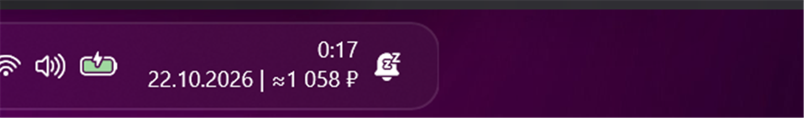
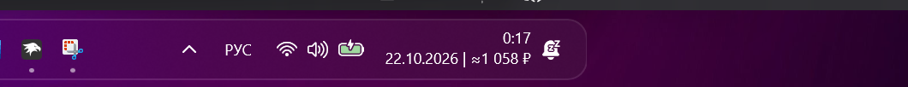

# DeepSeek Balance in Taskbar

A [Windhawk](https://windhawk.net/) mod that shows your DeepSeek API account
balance right in the Windows taskbar clock.





## Features

* Balance is appended to the taskbar clock: `22.10.2026 | ≈1 058 ₽`.
* Native currency (`CNY`/`USD`) or Russian rubles at the official Bank of
  Russia rate.
* Configurable refresh interval, currency, currency prefix and which clock line
  to use.
* Networking uses the built-in WinHTTP stack; JSON and XML are parsed by hand,
  no libcurl/OpenSSL/JSON libraries.
* All network work happens on a background thread with Win32 timeouts, so
  Explorer never blocks; the mod unloads cleanly.

## Installation

### From the Windhawk catalog

Once the mod is published, open Windhawk → **Browse** → search for
**DeepSeek Balance in Taskbar** → **Install**.

### From source

1. Install [Windhawk](https://windhawk.net/) 1.4 or newer.
2. Windhawk → **Create new mod**, paste the contents of
   [`deepseek-balance-tray.wh.cpp`](deepseek-balance-tray.wh.cpp), press
   **Compile**.
   The first local build may ask to download the development tools (LLVM).
3. Open the mod settings and paste your DeepSeek API key (`sk-...`).

Or with the CLI:

```powershell
windhawk-cli mod install --file .\deepseek-balance-tray.wh.cpp
```

## Settings

| Setting | Default | Description |
| --- | --- | --- |
| `apiKey` | empty | DeepSeek API key. If empty, the `DEEPSEEK_API_KEY` environment variable is used. |
| `refreshInterval` | `5` | How often to poll the API, in minutes (1…1440). |
| `formatPrefix` | `$` | Text before the amount in native mode (`$`, `¥`, `CNY `). |
| `currency` | `auto` | Which `balance_infos` entry to show: `auto`, `CNY` or `USD`. |
| `clockLine` | `date` | Append to the bottom (date) or top (time) clock line. |
| `displayCurrency` | `native` | `native` — CNY/USD as returned by the API; `RUB` — convert at the CBR rate. |

## How it works

* The mod hooks `GetTimeFormatEx` and `GetDateFormatEx` from `kernelbase.dll`,
  the functions the taskbar clock uses to format its text. On Windows 10 the
  clock lives in `ClockButton::UpdateTextStringsIfNecessary` (explorer.exe), on
  Windows 11 in `ClockSystemTrayIconDataModel::RefreshIcon`
  (`SystemTray.dll` / `Taskbar.View.dll` / `ExplorerExtensions.dll`).
* Those functions only flag "we are inside a clock refresh" (thread-local), so
  the decoration is applied to the clock and nothing else — dates in file
  properties and other Explorer UI stay untouched.
* A background `std::thread` polls
  `https://api.deepseek.com/user/balance` over WinHTTP and updates the suffix.
* In `RUB` mode it additionally downloads
  `https://www.cbr.ru/scripts/XML_daily.asp` (windows-1251, `Value / Nominal`),
  caches the rates for 6 hours and converts the balance.
* On network errors the last known value is kept; on a missing rate the native
  currency is shown instead of an empty line.

## Privacy

* The API key is stored in Windhawk's mod settings in plain text (Windhawk has
  no secret setting type). It is sent only to `api.deepseek.com` and is never
  written to the log.
* The only other network endpoint is `www.cbr.ru` (Bank of Russia) in `RUB`
  mode. No telemetry, no analytics, no third-party services.

## Compatibility

* Windows 10 (stock taskbar) and Windows 11 (XAML taskbar).
* Requires symbols (PDB) for `explorer.exe` / `SystemTray.dll`; Windhawk
  downloads them automatically on first start.
* The old Windows 10 taskbar on Windows 11 via ExplorerPatcher is not supported.
* Windhawk 1.4+ (uses `Wh_FindFirstSymbol` for internal symbols).

## Building

The mod is a single self-contained `.wh.cpp` file. Windhawk compiles it locally
with its own clang toolchain and MSVC headers:

1. Windhawk → **Create new mod** → paste the source → **Compile**.
2. Or `windhawk-cli mod compile deepseek-balance-tray` for an installed copy.

No additional libraries are required; `@compilerOptions -lwinhttp` links the
WinHTTP import library.

## License

MIT — see [LICENSE](LICENSE).
